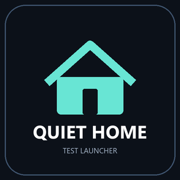

# Quiet Tizen for Samsung QN90B

A model-specific adaptation of [jss8649/quiet-tizen](https://github.com/jss8649/quiet-tizen)
for **Samsung QN55QN90BAFXZA**, owner-reported firmware **T-PTMAKUC-1720.7**.
The original project was the base for the launcher, UI assets, investigation and
recovery workflow. This repository documents what changed to make a separate,
developer-signed Quiet Home application work on this particular TV.

**Observed result:** the remote's Home button opens Quiet Home, including after
standby/wake and a full restart. Power-on still resumes the last HDMI input.
Automatic foregrounding into Quiet Home at boot was **not** established.

## What is different from the base project?

| Base case study | This QN90B adaptation |
|---|---|
| UN75U8000FFXZA / firmware 1300.9 | QN55QN90BAFXZA / T-PTMAKUC-1720.7 |
| Reuses a Samsung Bixby Promotion container | Separate Samsung developer-signed `QuietHome1` TPK |
| Replaces a stock launcher assembly | Preserves every stock app binary |
| Root-assisted deployment recipes | Final installation/routing used existing SDK UID901/System context; no root |
| Original runtime/assets and input examples | Matching TV .NET 3.1 references; inputs 13, 14 and 16 observed |
| Light UI / retained image cache | Black UI / visible-card PNG artwork |
| Private quick-setting implementation | Brightness, Game Mode and sleep timer delegate to Samsung settings |

The base's Bixby Promotion/QuickLaunch containers were absent on this TV. Its root
preflight also did not match the reported release family; no guard was bypassed.
A registered signed app solved the NUI startup problem. The existing SDK context
later accepted the Home-operation API and Home/startup preference changes.
This does not prove root access or compatibility with another TV.

## Features

- Native Tizen NUI/.NET launcher with HDMI cards, app library and remote navigation.
- Dark background, readable focus states, a local app icon and no test timeout.
- Public `AppControl` app launching; native Samsung settings retained.
- Standalone package `QuietHome1`, app `QuietHome1.Home`, source version `0.1.9`.
- Guarded per-device backup, routing readback and selector-specific restore tools.
- No stock-app replacement, database registry edits, system cleanup or hidden daemon.

## Start here

1. Read [compatibility and evidence](docs/01-compatibility.md).
2. Prepare Developer Mode, your own TV certificate and [private backups](docs/02-setup-and-backups.md).
3. Build and sign locally, then [test the standalone application](docs/03-build-and-test.md).
4. Only after functional tests, [assign Home and keep rollback available](docs/04-home-and-recovery.md).
5. Review [artwork and attribution](docs/05-artwork-and-provenance.md).

Do not run the original project's U8000F install recipes against a QN90B. Device
model, firmware, APIs and permissions must match the actual target before mutation.

## What was actually tested?

| Check | Evidence on the owner's TV |
|---|---|
| UI, remote navigation, app icons | Owner confirmed |
| PS5, Switch, Switch 2 input switching | Owner confirmed |
| Streaming apps, sound, native settings/network/Bluetooth | Owner confirmed the functional checklist worked |
| Home button | Owner confirmed Quiet Home opens |
| Standby/wake and full restart | Last input resumed; Home continued to open Quiet Home |
| Home/startup selectors | Read back as `QuietHome1.Home` |
| Installed-app preservation | 449 IDs retained disable/onboot/autorestart flags; no removals |
| Samsung Home background process | Not running in one post-restart snapshot; not globally disabled |

Functional checks are owner observations, not an automated hardware test suite.
All preservation counts include the separately installed diagnostic probe and
Quiet Home. No claim is made that every private setting write works, that startup
will foreground the launcher, or that performance/privacy improved quantitatively.

## Public source versus the private installation

The public repository omits the owner's publisher icons, custom app list, network
addresses, room photos, databases, certificates, DUID and Samsung DLLs. The sample
catalog contains three ordinary text-card examples. Supply your own installed-app
IDs and local PNG icons before deploying a customized library. The official PS
symbol is an optional local download; the public fallback uses plain PS5 text.
The sanitized public build is compiled and packaged locally, but has not replaced
the already-tested private installation on the TV.

## Local validation

After building, run `python -m unittest discover -s tests -v` and
`python tools/audit_public.py`. The five offline tests check package contents,
response parsing, three-selector apply/restore, rollback after a partial failure,
and refusal on selector drift using a fake TV. They do not replace hardware tests.

## Credits and license

Based on [quiet-tizen](https://github.com/jss8649/quiet-tizen), commit
`cf518d7a9278dca7990e27756218258e44044a29`. Its layout derives from
[Free My TV](https://github.com/simbasjungles/free-my-tv). Fonts, symbols and the
external SDK transport retain their own licenses. See [NOTICE.md](NOTICE.md),
[LICENSE](LICENSE) and [licenses/](licenses/). Independent community project;
not affiliated with Samsung, Sony or Nintendo.
